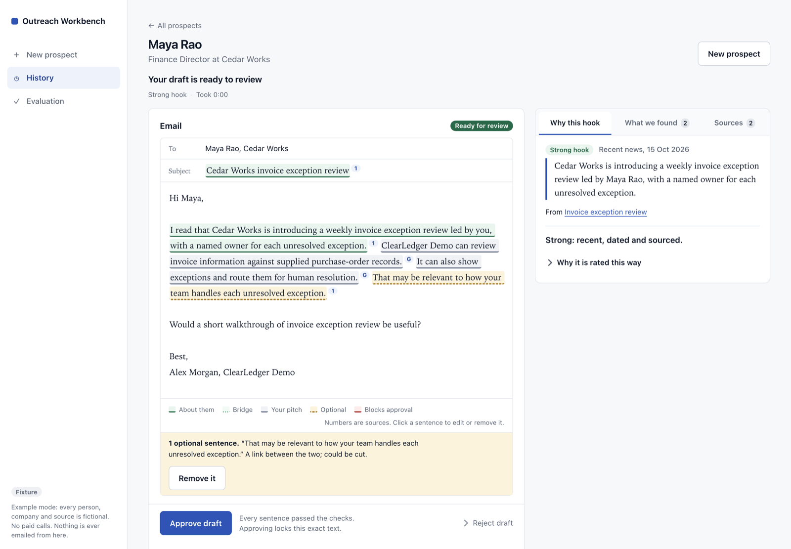
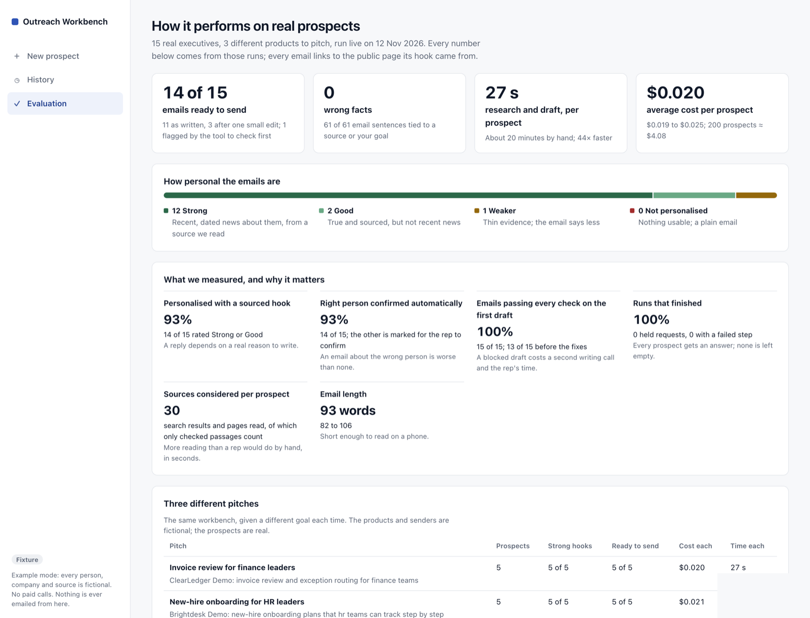
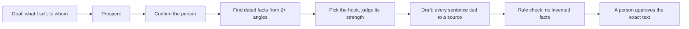

# Grounded Outreach

**Personalised B2B email where every sentence can be traced to a source, and nothing is
sent until a person approves the exact text.**

**[Live demo](https://grounded-outreach-demo.onrender.com)** (example mode: fictional prospects, no paid calls; the free server can take about a minute to wake) · [Evaluation](docs/WORKBENCH_EVALUATION.md) · [How it works](docs/WORKBENCH_OVERVIEW.md)



## The problem I saw

Cold outreach has two bad defaults. Mail-merge is generic and gets ignored. AI-written
email reads well but invents things: a "recent expansion" that never happened, a pain the
prospect never mentioned. A generic email gets deleted. A wrong one gets remembered.

I first hit this selling for my family's cotton thread business. Then I took it further:
can research and personalisation be automated without ever stating something untrue?

## What I built

One codebase, two modes.

| Mode | What it does | Sends email? |
|---|---|---|
| **Workbench** | Name a prospect and company. It confirms the person from public pages, finds a recent, dated reason to write, and drafts a 50–100 word email. Every sentence is linked to its source, and deterministic rules block invented pain, numbers, dates or certainty. | Never. You approve the exact text, then copy it. |
| **Campaigns** | Import a contact list and get grounded drafts. Review, edit and approve them, then send from a Gmail or Zoho account with pacing, a daily cap, dedupe, opt-outs and account-scoped replies. | Yes, after approval |

**Measured on 15 real executives across three different pitches:** 14 of 15 emails ready to
send (11 as written, 3 after one small edit), **0 wrong facts**, about 27 seconds and
**$0.02 per prospect**. The full report, with every email and the page its hook came from,
is in the app under **Evaluation** and in [docs/WORKBENCH_EVALUATION.md](docs/WORKBENCH_EVALUATION.md).





## Run the Workbench

```sh
uv sync --locked
uv run --locked python -m outreach.workbench --port 8780
```

Open <http://127.0.0.1:8780>. This is fixture mode: fictional prospects and sources, no
keys and no network. Pick an example under "Or try an example" to see the happy path and
the edge cases. Live mode (`--mode live`, keys in `.env`) uses Parallel search and
Claude Haiku 5.5 through OpenRouter, capped at $0.05 per run and $0.50 per day.

- **Overview** (process map, edge cases, decisions, limits): [docs/WORKBENCH_OVERVIEW.md](docs/WORKBENCH_OVERVIEW.md)
- **Run, verify, deploy:** [docs/WORKBENCH_RUNNING.md](docs/WORKBENCH_RUNNING.md)

## Verify

```sh
uv sync --locked --extra dev
uv run --locked pytest      # ~940 tests, no keys or network needed
uv run --locked python scripts/check_workbench_browser.py --browser "/Applications/Google Chrome.app/Contents/MacOS/Google Chrome"
```

The Workbench runtime is `src/outreach/workbench.py` → `wiring.build_workbench_app`. Core logic
is in `src/outreach/core/workbench*.py`, providers in `src/outreach/adapters/workbench_*.py`, and
pages in `src/outreach/web/`. The sections below describe the Campaigns mode.

## Campaigns mode

A personalized B2B outreach tool: one genuinely personalized email per
recipient, grounded in that recipient's own data, sent at a controlled rate
from an authenticated domain, with account-scoped replies, suggested answers that wait for approval, and
global opt-out protection. Automatic follow-ups are deferred.

Built for a family RFD cotton thread business in Ludhiana, reaching potential
buyers and manufacturers at roughly 20–30 emails a day. Quality over volume:
at that rate, every draft can be read by a human before it goes.

**Status: v1 complete.** A contact list goes in; grounded drafts come out; a
person reviews, edits and approves them in a local web page; approved drafts
are sent from a campaign's Gmail or Zoho account with a compliance footer,
capped and paced, with duplicate and opt-out protection. The browser workspace
also includes research planning, lead review, saved lists and multiple campaigns.
The full desktop journey is verified with simulated providers. Gmail/Zoho OAuth
and HTTPS mail adapters are implemented; hosting configuration is prepared.
Live OAuth consent and inbox delivery still need activation. Automated research
works, but the latest Bangalore test found a general inbox, so requested contact
quality remains unresolved. See [campaign readiness](docs/CAMPAIGN_READINESS.md)
and [laptop setup](docs/LAPTOP_SETUP.md).

---

## The problem this solves

Mail-merge gets ignored. Writing two hundred emails by hand doesn't scale. The
gap between them is the whole product — and two things in that gap are harder
than they look:

**Reputation, not the model call.** A domain that has never sent email has no
standing. Send badly for a week and you are in spam folders for months, and no
amount of better code fixes it. So the domain, DNS and warm-up run as a
separate track from day one, because they are bound by calendar time rather
than engineering speed.

**Grounding, enforced by code.** An email that invents a fact about a recipient
is worse than a generic one: generic gets deleted, wrong gets remembered.
"The prompt says not to" is not a control. So a claim about a recipient must
trace back to a cell in the file you supplied, and the code checks it.

---

## How it is built, and why

**Python.** The mail layer is the riskiest part of this system, and
`smtplib`, `imaplib` and `email` are standard library — so the riskiest layer
is also the one with no third-party dependency. Pydantic gives schema-validated
model output directly.

**SQLite.** One file, real transactions, no operations burden. Transactions are
what make the do-not-contact guard enforceable rather than aspirational. At
30 emails a day it will never be the bottleneck.

**Claude (`claude-opus-5`) for drafting.** The product *is* writing quality.
Measured across candidate models, the spread between best and cheapest is about
$19 a month at this volume — less than one good reply is worth.

**Zoho Mail over SMTP and IMAP.** A real mailbox is how cold outreach is
legitimately done; most transactional email providers prohibit it outright.
SMTP and IMAP are open protocols, so the provider stays a setting.

Every one of these is written up in [`docs/DECISIONS.md`](docs/DECISIONS.md)
with the alternatives and why each was rejected.

### The one structural idea

Three folders carry the whole design:

```
core/       the logic. Knows nothing about Zoho, Claude or SQLite.
ports/      the sockets:  "something that can send an email"
adapters/   the plugs:    "Zoho, over IMAP"  ·  "Claude, over the API"
```

A travel adapter: `core` is the appliance, `ports` is the plug shape,
`adapters` is the country-specific pins. Change country, change the adapter,
the appliance is untouched.

This is enforced, not just intended. `tests/test_architecture.py` reads every
file and fails the build if anything outside `adapters/` imports a vendor
library. `cli.py` is the single documented exception — something has to wire
the concrete pieces together, and that is the entry point's job.

The payoff is that switching from Zoho to Google Workspace, or Claude to
another model, is a configuration change rather than a rewrite.

---

## Running it

**In a browser, with no local setup** — open the repository on GitHub and select
the `codex/research-pilot-v1` branch. Use **Code → Codespaces → Create codespace**.
Pressing `.` opens an editor without the server needed to run this Python app.
The Codespace installs dependencies and runs the tests. In its terminal, run:

```bash
bash .devcontainer/preview.sh
```

Choose a workspace password when prompted. In the **Ports** tab, open port **8000**
with **Open in Browser**, keep its visibility **Private**, and sign in with your
chosen password. The app runs in that Codespace while its terminal remains open.
The preview disables automatic inbox polling; browsing alone makes no paid AI
requests. Research, drafting and sending remain explicit actions.

For research, add `OUTREACH_OPENROUTER_API_KEY` and `OUTREACH_PARALLEL_API_KEY`
under your GitHub **Settings → Codespaces → Secrets**, grant this repository access,
then stop and restart the Codespace. Codex Cloud environment variables do not
automatically transfer into GitHub Codespaces. You can inspect the screens without
these keys. Codespaces usage may have a hosting charge separate from API spending.
See [the workspace guide](docs/WORKSPACE_GUIDE.md) for permanent hosting and mail setup.

**On your own machine** — the only prerequisite is
[uv](https://docs.astral.sh/uv/), which also installs the right Python for you:

```bash
git clone https://github.com/AkshGoyal/outreach-agent.git
cd outreach-agent
uv sync --extra dev    # every library, at the exact versions in uv.lock
uv run pytest          # offline tests — no API keys or live services
```

`pyproject.toml` lists what the project needs; `uv.lock` pins the exact
version of every one of them, so every machine gets the same thing. Prefix any
command with `uv run` and there is nothing to activate.

Either way, start with:

```bash
outreach check   # confirms your settings, and that your API key works
```

The test suite deliberately needs no credentials: every external service sits
behind a port, and tests use stand-ins for the port rather than for the vendor.
Change provider and not one test changes.

To import a contact list:

```bash
outreach import contacts.xlsx --campaign rfd-buyers-q4            # preview
outreach import contacts.xlsx --campaign rfd-buyers-q4 --commit   # write
```

Without `--commit` nothing is written. It prints which column it believes holds
the email address, and lists every rejected and duplicate row with its
spreadsheet row number. `--email-column "Header"` overrides the guess.

Importing needs no credentials at all — it touches no mailbox and no model, so
you can clone this and try it immediately. Copy `.env.example` to `.env` when
you reach a command that does send or draft; each command checks what it needs
before doing any work, and names the exact environment variables if any are
missing.

---

## How it works, end to end

**In the browser** — `uv run outreach serve` opens it. Each campaign card shows
its next step: Setup (test the Zoho login and the AI key) → Import a
spreadsheet → Offer & ending → Write drafts → review, or "Approve all that pass
every check" → "Send me a test" → Send, with live progress and a Stop button.
Replies land in the **Inbox** page — matched to the company, sorted, with any
postal address they give pulled out and an answer suggested for you to edit
and send. Anyone who says no, and any address that bounces, goes on the
do-not-contact list automatically.

**Or in the terminal**, the same steps:

```bash
uv run outreach import leads.xlsx --campaign rfd --sheet "Buyer Leads" --commit
uv run outreach serve        # opens the web page: Drafts and review → Write drafts
                             # read each one, edit, Approve — or "Approve all that pass every check"
uv run outreach send --campaign rfd            # dry run: shows exactly what would go
uv run outreach send --campaign rfd --really   # sends, a minute apart
uv run outreach status                         # where every campaign stands
uv run outreach replies                        # check the inbox and sort replies
```

A second list goes into the same campaign the same way. Contacts already there
are skipped, `draft --save` drafts only the new ones, and anything already
emailed is never emailed again. Sending runs up to the daily cap and picks up
where it left off the next day.

Added or changed the closing after drafting? `draft --save --redraft` rewrites
everyone not yet emailed; their old drafts are marked rejected so they can't go
out. Either way, a draft whose text repeats the closing is refused at approval,
at `send-test` and at `send` — the check runs again where the email leaves.

Before drafting a whole list, `draft --campaign <id> --limit 1` prints one
email in full, exactly as it would arrive, to judge the flow by.

**Importing** reads `.csv` or `.xlsx`, works out which column is the email
address, rejects rows it cannot use with their spreadsheet row numbers, catches
duplicates, and keeps each contact's facts as *evidence* — a cell's literal
text, with your own bookkeeping columns left out.

**Drafting** hands the model those facts and nothing else, and gets back a
subject and a list of sentences, each naming the fact it used. The schema only
accepts that contact's real field names, so a model cannot cite a source that
does not exist. Then plain code checks every name, place, number and product
term against the evidence and your campaign copy:

```
 ok  You make knitted cotton fabric for export in Tiruppur.
 XX  I believe we met at your Coimbatore stall last year.
       -> Nothing we hold mentions 'coimbatore'.        (removed before you see it)
 ?   Your team clearly cares about quality.
       -> About them, but says nothing checkable.       (your call)
```

**A fixed closing**, if a campaign has one (`campaigns/<id>.closing.md`), is
added word for word under every email. The model then writes only the opening,
and anything it writes that repeats the closing — or an earlier sentence — is
taken out, with the reason shown.

**Reviewing** happens in a local web page. A draft cannot be approved while
any line is unsupported — including a line you typed. If something true is
missing, it goes in the spreadsheet.

**Sending** is a dry run unless you say otherwise. It holds back anyone on the
do-not-contact list, anyone already written to (including a send interrupted
by a crash, which it will never repeat), and anything past the daily cap. Every
email carries your name, company and address, and tells the recipient they can reply to
opt out — written as a signature rather than newsletter boilerplate, because the
boilerplate version landed in Gmail's Promotions tab (D-018).

## Deliberately not built

**Reading replies and sending follow-ups.** At the current volume — seven
contactable leads — reading replies in Zoho is faster than automating it. The
design for both is in the roadmap; building them before there are real replies
to design against would be building against imagined ones.

**The real constraint is addresses, not software.** Of 44 researched leads, 7
have a published email address. Finding the rest is the next piece of work.

## The documents

| | |
| --- | --- |
| [`CLAUDE.md`](CLAUDE.md) | The working agreement this was built under |
| [`docs/ROADMAP.md`](docs/ROADMAP.md) | Phases, where we are, what is still open |
| [`docs/DECISIONS.md`](docs/DECISIONS.md) | Every decision, its alternatives, and why each lost |
| [`docs/ARCHITECTURE.md`](docs/ARCHITECTURE.md) | Components, storage, and the invariants |
| [`docs/FAILURE_MAP.md`](docs/FAILURE_MAP.md) | If X breaks, look here |

Real recipient data never enters this repository. `data/`, spreadsheets,
databases and `.env` are excluded from the first commit onward; the fixture
list is fictional.

## Browser research and campaigns

The workspace now supports research briefs (with optional browser dictation),
editable plan approval, bounded Parallel/OpenRouter research, source evidence and
bulk lead review, saved audiences, and new/existing campaigns with separate Gmail
or Zoho accounts. Draft all emails, review and approve them, confirm paced sending,
and manage replies in the campaign's assigned inbox. Projects, tags and filters
keep multiple campaigns easy to navigate.

Run `uv run outreach serve --no-browser` and follow the
[workspace guide](docs/WORKSPACE_GUIDE.md). Network-facing Cloud access requires
`OUTREACH_APP_PASSWORD`, an allowed hostname, HTTPS and one server worker. Live
SMTP/IMAP requires a Cloud application host with outbound mail ports; this Codex
execution environment supports HTTPS research but cannot reach public mail servers.

The comparison pilot used $0.407160 of its $1 limit; its candidates remain pending
review. [Pilot results](docs/RESEARCH_PILOT_RESULTS.md) and the
[multi-campaign plan](docs/PLATFORM_PLAN.md) are preserved.
