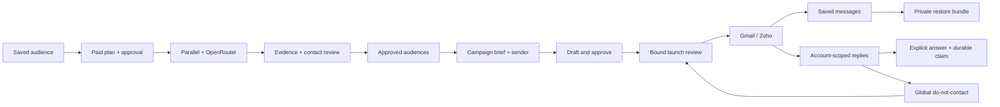
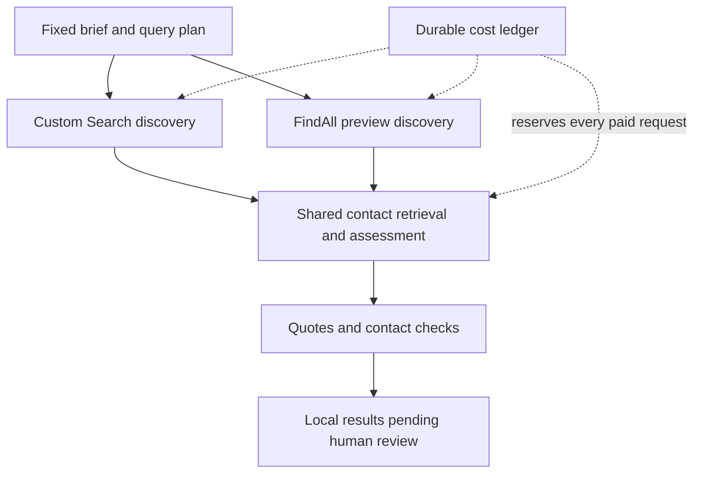
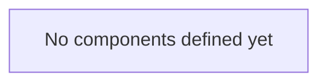
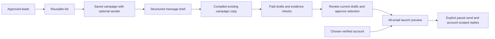
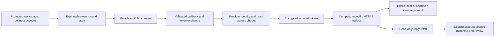
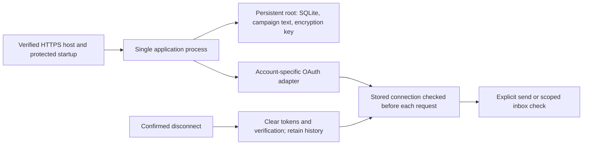
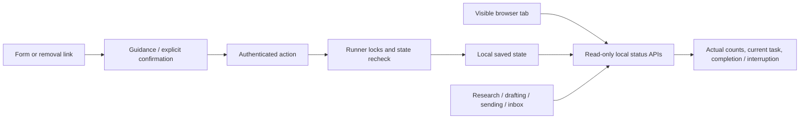
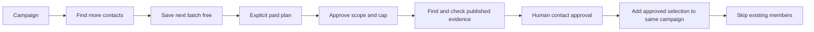
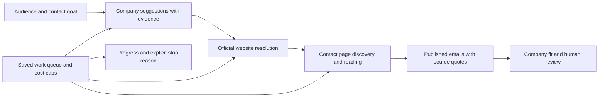
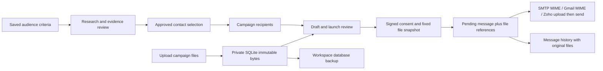

# Architecture

## Current flow — 2026-10-05

The browser saves an audience, asks for missing essentials, creates an AI plan
with explicit paid consent, then runs separately approved research. Reviewed
source-backed leads become lists and campaign contacts. Campaigns keep their
message brief and selected Gmail/Zoho sender. Drafts wait for review; launch consent
binds exact emails and sender. Saved outbound messages support account-scoped reply
matching, explicit answers and global suppression. Private bundles preserve SQLite,
campaign text and the credential key. One process runs jobs while the app is alive.



Schema 9 adds `reply_sends` and `draft_test_runs`. Reply claims are saved before
network I/O and retained after a crash, even if no message row was written yet.
Only a known failed answer may be explicitly retried; sent/pending claims remain
blocked. Pending messages reserve daily capacity without being called delivered.
An uncertain delivery stops the batch.

`web/launch.py` signs a 15-minute snapshot with an in-memory secret, making reviews
invalid after restart. `web/jobs.py` keeps the reviewed selection and rechecks
approval/suppression/cap at delivery. `adapters/workspace_backup.py` verifies private
archives; workspace sign-in protects download routes.

`experiments/workspace_pilot.py` wires actual production research through the
existing pilot Runtime: both SQLite's $0.12 run gate and the original $1 ledger
reserve before paid requests. It uses an isolated private DB, creates no campaigns,
and keeps results pending review. Normal production research retains its separately
configured budgets; this bridge is only for the bounded pilot.

The older phase-status notes below describe historical increments; this flow and
the appendices supersede their earlier placeholders. See CAMPAIGN_READINESS.md.

## Isolated research experiment (2026-10-03)

`experiments/research_pilot.py` owns fixed briefs, discovery and evidence checks;
`experiments/pilot_runtime.py` owns direct HTTP calls, credentials and the durable
cost ledger. This development-only experiment is outside the production package;
production integration must use the existing port/adapter pattern. It imports
no mail or campaign database modules. See [RESEARCH_PILOT.md](RESEARCH_PILOT.md).



All outputs stay in ignored `data/research-pilot-v1/`. Dependencies are HTTPX,
python-dotenv and Pydantic, already present in the development environment.
No campaign records are created by this experiment.

> **Status: Phase 4 core complete** — grounding and drafting exist and are
> tested; not yet wired into the command line or the web pages. Ports, adapter stubs, config, the data model,
> both suppression guards, and spreadsheet import. Sections 1-4 stay unfilled
> until the end-to-end flow exists (Phase 4 onward). Sections 5-8 are current.

---

## 1. System overview

*One paragraph: what the system does, end to end, in plain language.*

## 2. Components and responsibilities

*One row per component. A component has exactly one reason to change.*

| Component | Responsibility | Owns (data / side effects) | Does **not** do |
| --- | --- | --- | --- |
| _tbd_ | | | |

## 3. End-to-end data flow

*Numbered walkthrough of one recipient's full journey: import → ground → draft →
review → send → reply → classify → route → follow-up or stop. Name the component
and the stored state at each hop.*

## 4. Diagram



*Keep this diagram in sync with §2 and §3. If they disagree, the diagram is
wrong.*

## 5. Module map

```
src/outreach/
  config.py                  settings, validated at startup (fails fast)
  cli.py                     command line entry point
  web/app.py                 local web interface — same code, a browser
                             (both are composition roots: the only files that
                              may name a specific adapter)
  core/
    models.py                the project's own vocabulary
    normalize.py             the ONE way an address is written down
    sending.py               the only way to send — both suppression guards
    importing.py             reading a list: column guessing, checks, evidence
    grounding.py             is this sentence something we can back up?
    drafting.py              write one email, then check it before anyone sees it
  ports/
    mail.py                  MailPort  — what a mailbox must be able to do
    llm.py                   LLMPort   — what a model must be able to do
    store.py                 StorePort — what storage must be able to do
  adapters/
    mail_smtp_imap.py        Zoho over SMTP/IMAP        (stub — Phases 6 & 7)
    llm_anthropic.py         Claude over the API        (stub — Phase 4)
    db.py                    SQLite connection, schema, suppression triggers
    store_sqlite.py          StorePort in explicit SQL
    llm_anthropic.py         Claude directly, with retries and refusal handling
    llm_openrouter.py        OpenRouter — many models behind one key
    spreadsheet.py           .csv / .xlsx into plain rows
    backup.py                a verified, single-file copy of the database
prompts/
  draft_email.md             the drafting instructions, versioned in a file
campaigns/
  <campaign-id>.md           what you are offering, per campaign — the only
                             thing a draft may claim about your own business
tests/
  fakes/mail.py, fakes/llm.py   stand-ins for the PORTS, not for the vendors
  test_config.py, test_ports.py, test_db.py
```

**Dependency rule — one sentence:** `core` and `ports` may not import
`adapters`, and nothing outside `adapters/` may import a vendor library
(`smtplib`, `imaplib`, `email`, `anthropic`, `sqlite3`, `openpyxl`, `csv`).

**The exceptions:** `cli.py` and `web/app.py`. Something has to decide that
"the mailbox" means Zoho and "storage" means SQLite, and wire them together.
That is an entry point's job and nowhere else's. Both are named by path in
`tests/test_architecture.py` rather than the rule being relaxed.

The web interface calls the same functions as the command line — it is a second
face on one system, not a second implementation, so the two cannot disagree
about what an import does.

Direction of dependency: `adapters → ports → core`. Never the reverse.

The layout encodes the rule so a violation is visible in the file tree rather
than remembered — and `tests/test_architecture.py` now enforces it, so a commit
that breaks the rule fails the suite. The test was itself checked by
introducing a deliberate violation and confirming it failed.

## 6. External dependencies

The separate research pilot uses Cloud runtime credentials for Parallel and
OpenRouter; runtime readiness confirms configuration, while provider responses
establish authentication. Its first Cloud attempt stopped on an expired key;
explicit recovery retained that reservation and recorded a separate request.
Both providers now authenticate and all four comparisons completed. Cached
assessments and source maps support offline revalidation and review; criterion
labels accept declared keys/descriptions while literal quote checks remain.
It does not open the campaign database or mailbox. See
[the run record](RESEARCH_PILOT.md#cloud-comparison-completed-2026-10-03) and
[measured limitations](RESEARCH_PILOT_RESULTS.md).

*Everything we do not control. For each: what we use it for, what it costs, what
happens when it is unavailable, and how hard it is to swap.*

| Dependency | Used for | Failure impact | Swap cost |
| --- | --- | --- | --- |
| Zoho Mail (SMTP + IMAP) | Sending outreach; reading replies | No sends and no reply ingestion. Mail already delivered is unaffected and still readable in any mail client. | **Low, by construction** — credentials and host in config. Any SMTP/IMAP provider substitutes without code change above the mail port (§8). |
| GoDaddy / Vercel (DNS) | MX, SPF, DKIM, DMARC for `starthreads.in` | Authentication fails → mail lands in spam or is rejected outright. | High — DNS is the domain's identity; changes propagate slowly. |
| OpenRouter (model is a setting) | Drafting; reply classification | No new drafts, no classification. Already-approved drafts still send. | **Low, by construction** — provider and model are config behind the LLM port (I-6). Two adapters now exist, which is the proof: switching is `OUTREACH_LLM_PROVIDER`. |

## 7. Stored state

| Table | Key | Written by | Holds |
| --- | --- | --- | --- |
| `schema_meta` | `key` | `adapters/db.py` | Schema version |
| `campaigns` | `id` (slug) | `store_sqlite` | One outreach push |
| `contacts` | `id`; unique on (campaign, email) | `store_sqlite` | A business, and the evidence we hold on it |
| `suppressions` | `email` | `store_sqlite` | The do-not-contact list. **Global, never per-campaign** |
| `messages` | `id`; unique `message_id` | `store_sqlite` | Emails sent, written as `pending` *before* the send |
| `replies` | `id` | Phase 7 | Replies; `message_id` nullable so an unattributed reply is still kept (I-4) |

Two deliberate choices worth remembering. `messages.recipient_email` duplicates
the contact's address so that the database guard can check a row without
following a join, and so the record shows the address actually written to. And
the `pending` status exists so a crash mid-send leaves visible evidence rather
than an email with no record, which the next run would send again.

The database file lives under `data/`, which is git-ignored. It will hold
recipient PII, draft bodies and reply text. It needs a backup destination that
is not a public cloud folder — see FAILURE_MAP §4.

## 8. Invariants

*Properties that must hold at all times, and where they are enforced in code.*

| # | Invariant | Enforced in | Source |
| --- | --- | --- | --- |
| I-1 | **No code outside the mail port speaks SMTP, IMAP, or any provider-specific mail API.** Everything above it deals only in the project's own message and reply types. | `ports/mail.py` defines it; `adapters/mail_smtp_imap.py` is the only permitted implementor. Enforced by `tests/test_architecture.py`. | D-002 |
| I-2 | No send may occur without a suppression check. **Two guards:** `core/sending.py` refuses before anything is written or sent; the `refuse_insert_to_suppressed` / `refuse_update_to_suppressed` triggers in `adapters/db.py` reject the row even if that code is bypassed. | `core/sending.py` + SQLite triggers. 12 tests in `tests/test_suppression.py`, including one that bypasses the application code entirely. | brief §3.2 |
| I-3 | No recipient-specific claim may reach a draft unless it traces to a stored evidence field. | `core/grounding.py` — every specific must appear in the recipient's evidence, their company name, our approved copy, or the sender's name. Enforced in plain code, no second model call. 26 tests in `tests/test_grounding.py`, most of them deliberate lies that must be caught. One known gap is recorded as a test rather than hidden. | brief §3.3, D-011 |
| I-4 | A reply that cannot be attributed to a thread is surfaced to a human, never dropped. | _tbd — Phase 7_ | D-002 |
| I-5 | No follow-up after a reply, after an opt-out, or past the cap. | _tbd — Phase 8_ | brief §3.4 |
| I-6 | **No code outside the LLM port calls a model provider's SDK.** Provider and model are configuration. | `ports/llm.py` defines it; `adapters/llm_anthropic.py` is the only permitted implementor. Enforced by `tests/test_architecture.py`. | D-007 |

I-1 and I-6 are what make D-002 and D-007 reversible decisions rather than
permanent ones. If either erodes, the choice of Zoho over Google Workspace — or
of Claude over Gemini — stops being a config value and becomes a rewrite. Both
are worth defending in review.

## Browser workspace increment (2026-10-04)

`web/app.py` composes `web/platform.py`, `ResearchRunner`, `DraftRunner`, optional
operator sign-in and the existing send/inbox jobs. `PlatformStore` adds projects,
accounts, campaign settings, runs, request accounting, company observations, lead
lists, reviews and contact-origin links without rewriting existing contact history.
`CredentialVault` encrypts app passwords using a key outside SQLite. `MailboxStore`
scopes reply matching to the campaign account. `wiring.py` resolves campaign identity
for browser and CLI drafting/sending. External research access stays in `ResearchAPI`
and behind the research port; core evidence checks do not call provider SDKs.


Each paid research call reserves cost before HTTP and caches successful responses.
No production workflow imports the experiment ledger. Schema v5 uses additive tables.
Research and account credentials are Cloud settings; mailbox passwords are encrypted
application data. HTTP research works in this Codex environment; public SMTP/IMAP
requires an application host with appropriate outbound connectivity. See
[operation and recovery](WORKSPACE_GUIDE.md).

The Codespaces preview launcher (`.devcontainer/preview.sh`) starts the same app
factory on port 8000, sets the exact forwarded hostname, and requires an operator
password. It leaves automatic inbox polling disabled; operator-triggered workflows
are unchanged. This development preview is separate from permanent hosting and
provider OAuth registration.

`demo/mobile-preview.html` is a separate, self-contained browser workflow demo.
Its fictional records stay in browser local storage; it never calls the Python
app or research/mail APIs. `render.yaml` declares an optional static deployment
of `demo/` for phone browsers. It does not deploy application data or credentials.

The founder experiment (`experiments/founder_benchmark.py`) invokes production
planning/research using an isolated ignored SQLite database. Its paid adapter
reserves in both the original pilot ledger and the production store before HTTP,
requires matching completed checkpoints for cache reuse, and retains uncertain
charges. The diagnostic founder schema remains experimental and does not update
production lead fields. Production source windows now prioritise founder roles,
real email patterns and Bangalore location passages. The proposed frontend flow
is documented in FRONTEND_PRODUCT_PLAN.md; it is not a replacement app yet.

The approved frontend design now supports a founder → HR/recruiting or named
senior-management fallback in audience preferences, with explicit role evidence.
This remains planned production integration. A separate manual public-site review
saved two pending department contacts and source-backed facts in ignored JSON/CSV;
the existing production importer previews both CSV rows without database writes.
The prior paid benchmark records and accounting are unchanged.

## Guided intake increment (schema 6)

`core/intake.py` validates saved audience preferences, derives clarification
questions and constructs the provider brief. `research_intakes` stores JSON beside
existing run identities, created additively during bootstrap; pre-existing records
have no intake and retain legacy search fingerprints. `PlatformStore.save_intake`
is called in a transaction and rejects changes after planning/spending starts.

`web/platform.py` serves `/research/new`, saves `/research/intake` or
`/research/{id}/intake`, and starts planning only with complete preferences and paid
authorisation. The separate existing plan-approval route starts discovery. Accepted
roles feed new runs' company search queries in `core/research_flow.py`; publication,
role ownership and deliverability remain separate review concerns.


Shared intake templates use real routes. `workspace.js` keeps optional unsubmitted
changes in sessionStorage and manages selection state; paid authorisation is never
restored. `style.css` supplies five mobile tabs, management links and lead cards.
The standalone phone demo, hosted deployment and OAuth are unaffected.

## Campaign preparation increment (schema 7)

`core/message_brief.py` validates topic, supplied introduction/background, request,
tone and name, and compiles complete preferences into the existing campaign copy.
`campaign_briefs` is an additive one-to-one JSON table; old campaigns default to no
brief and keep their raw copy. Message routes save both representations; legacy raw
editing clears the JSON. Compiled text/ending changes invalidate unsent approvals.
`PlatformStore.save_campaign` accepts no/unverified accounts for draft preparation,
but active status requires verification and mail history prevents identity changes.

`web/platform.py` handles approved-selection list handoff, list enrollment and message
editing. `web/app.py` supplies campaign context/checklist, draft filters, scoped selected
approval, current-version review navigation and complete outgoing previews. Shared
Jinja header/fields reuse existing routes and records. `wiring.campaign_settings`
clears environment mail identity/credentials for a new workspace campaign with no
account; verified operations require both message copy and a chosen verified account.
Legacy campaigns without workspace settings retain existing environment behavior.



`core/drafting.recipient_facts` excludes reserved `research_run`/`review_note` fields
from both prompts and grounding for legacy evidence too. New enrollment preserves
provenance in origins/research records instead of injecting it into drafting facts.
Facts remain subject to existing checks and human semantic review. Selected approval
verifies current draft IDs belong to the campaign before mutation; unsent message
changes invalidate approvals, while sent records and history stay intact.
Browser restoration excludes every consent field. No new external dependency is added.
SQLite and campaign files still need joint backup; cross-file writes and workers are
not a multi-process durable queue. OAuth/hosting remain separate unfinished work.

## OAuth mail (schema 8)

`adapters/oauth_mail.py` owns provider URLs, authorization/code exchange, token refresh,
mail identity and HTTP transports. HTTPX inherits Cloud proxy/CA settings; send POSTs
never retry. `web/oauth.py` handles protected connection starts, browser-bound
callbacks, setup readiness and confirmed test delivery through injected factories.
`wiring.build_mailbox` selects the API adapter for OAuth identities and SMTP/IMAP for
legacy accounts. Settings expose account IDs, not tokens; transport-specific send
requirements retain footer identity checks. Public account queries expose provider
names only. `mail_oauth` encrypts tokens, `oauth_attempts` stores hashed state/browser
bindings plus encrypted pending details, `mail_api_ids` maps local/remote/internet
message IDs within one account, and `mail_test_runs` preserves replay-safe outcomes.



Only the two exact OAuth callbacks bypass workspace-password middleware because
cross-site consent returns lack its Strict cookie. Callbacks still require the
Secure HttpOnly Lax sign-in cookie, unexpired stored state and canonical host; they
do not create a workspace login. Google PKCE verifier is encrypted server-side.
Callbacks use no-referrer while normal forms retain same-origin referrers; applying
no-referrer globally breaks Chromium form Origin checks. Launchers disable access
logging to keep authorization codes out of logs. Zoho endpoints use selected
allowlisted regions, not callback-supplied URLs. Inbox reads never mark/delete mail.

Gmail sends the existing MIME format; Zoho sends plaintext through its documented
send/reply endpoints and retrieves sent MIME to map its assigned Message-ID. Failure
or missing receipt after submission is uncertain and preserves pending sends.
The test-to-self path consumes a unique request before submission and records accepted,
failed or uncertain outcomes; campaign contact/suppression fences remain. Live testing
and Google verification/Zoho plan compatibility require external setup, not fakes.

## Hosted startup and account recovery

`hosted.py` is a startup/composition entrypoint: settings come from the environment
without a repository .env, HTTPS origin derives from host metadata or an explicit
origin, the database must live in the persistent root, and campaign-relative paths
resolve there after chdir. The existing source/template/prompt paths remain absolute
in the editable locked production build. Uvicorn runs one process with polling and
access logs off; proxy trust defaults to loopback and can use a verified host-specific
list. Workspace cookies are Secure for a configured HTTPS origin even before the
backend proxy is configured. `deployment/render.yaml` is a proposed native-Python
paid backend/disk; the root sample blueprint is separate. Nothing is deployed here.



`web/oauth.py` reads saved test outcome history and handles confirmed local disconnect
inside a transaction. The account/provider/history remain; token cipher is cleared
and unsent approvals are demoted. `oauth_mail.py` checks stored connection before
requests and refuses a refresh that could resurrect disconnected tokens. Refused
permissions clear verification with a sanitized message. Provider revocation remains
an account-owner action. No new schema is needed beyond schema 8.

Inbox route context supplies account/campaign names and account-scoped reply IDs.
Selected checks never append unrelated or legacy environment mailboxes; all-account
checks retain existing behavior. Sending retains existing dispatch/suppression/cap
checks. Test outcomes survive restart, while worker progress remains in memory;
pending-delivery reconciliation and durable queues still need operational work.

## Laptop guided workflow (2026-10-06)

Existing HTML routes and backend forms remain. workspace.js progressively shows goal,
audience and free saving; validates hidden optional fields; restores only drafts matching
the saved version; and blocks paid planning until unsaved scope edits are saved. Secret
forms do not opt into browser draft storage.

adapters/provider_credentials.py encrypts keys using CredentialVault and atomically
replaces provider-credentials.enc beside the database. web/app.py applies stored
overrides before wiring providers; empty fields keep existing keys and active jobs
block changes. .env is untouched. CLI environment settings remain independent.

web/local.py runs one loopback Uvicorn server. scripts/restart_local.py privately
authenticates a graceful handoff from restricted preview to the owner launcher.
Active research, drafting and sending refuse restart. Routes and ResearchAPI both
block restricted paid work before new reservations.


The earlier password-based account was encrypted into the new account store and left
unverified. Old contacts, drafts and send history remain in the earlier folder.
API-key presence and reused passwords do not establish current authentication.

### Connection diagnostics and launcher readiness (2026-10-06)

provider_connection.py validates the saved OpenRouter key through its documented read-only metadata endpoint. POST /setup/providers/check-openrouter is authenticated and same-origin protected; only sanitized result text reaches the UI. It creates no research run/reservation or model completion. Parallel access/credits are owner dashboard checks. Restricted email verification returns restart guidance without opening a transport or changing stored verification. The local launcher uses .venv Python directly; --open-browser waits for Uvicorn's started state.

### Removal and live feedback (2026-10-06)

web/workspace_controls.py installs authenticated removal review/action routes and GET /workspace/activity. It uses injected storage and runners. Removal acquires runner locks and a database write transaction, then rechecks eligibility. research_archives is an additive FK table; default run listings exclude its entries. Permanent audience deletion removes only intake/conversation/archive metadata for an unused run. Campaign deletion is limited to empty drafts with no message files; no filesystem deletion is performed. Archives keep all historical tables and ledger rows. Campaign restore returns paused and invalidates unsent approvals.

platform.py shares crashed-worker recovery between HTML details and GET /research/{id}/status. Both status APIs use no-store and do no external work. workspace.js polls while visible, aborts slow requests, backs off failures, and stops research polling at terminal states. Background job snapshots update counts and completion links without replacing form state. POST feedback preserves the submitter's name/value and does not disable submitted fields; duplicate clicks are prevented. Backup downloads keep native handling.




### Cached discovery recovery and editable inputs (2026-10-07)

core/discovery.py shares discovery source-window construction and candidate validation with research_flow.py. An exact-host cited article can substantiate its homepage; different domains, unpublished deeper paths, private URLs and unsupported identity quotes remain excluded. saved_discovery reads only completed cached request payloads, deduplicates existing candidates and caps recovery to the remaining target. recover_saved_discovery runs under the research lock and a write transaction, adds unprocessed candidates and pauses a completed run without changing its request ledger or approved inputs.

web/research_view.py builds presentation counts and cost categories without exposing cached provider responses. Research HTML/status use the same summary: completed, waiting only while active, or an uncertain outcome requiring inspection. Unprocessed candidates have a separate Checks not finished review stage.

GET /research/{id}/edit prefills all audience inputs. Unused drafts save in place; POST /research/{id}/revise creates a free draft even if a submitted action requests planning. Original runs, approvals and calls remain intact. POST /research/{id}/recover-discovery performs only local cache recovery. The running desktop Python process must reload these routes; older template contexts show an update notice.


### Campaign research batches (2026-10-07)

campaign_research_runs is an additive table linking a research run to one campaign; both foreign keys cascade association cleanup. PlatformStore.campaign_runs also discovers earlier batches from enrolled contact_origins, so existing evidence remains reachable without rewriting it.

GET /campaigns/{id}/research shows related progress/results and can prefill any chosen saved audience. POST to the same route shares the audience validator and always creates a free draft, even if the submitted action requests planning. Revised linked audiences keep the campaign association. Each run retains its own approval and cap. Research details preselect the campaign for approved-contact enrollment; existing review, suppression and duplicate protections remain unchanged. Campaigns with linked research archive rather than qualifying for empty-draft deletion.

_campaign_research_batch.html puts limits first and collapses reusable audience inputs. Earlier batches and alternative audience selection are optional details. Global invalid-field handling opens ancestor details before native focus. Older template contexts keep buttons visible: existing campaign edit/new-audience routes work; unavailable editing/removal links lead to the update notice.




### Final flow, deletion and research update (2026-10-07)

The top-left name is Complete Outreach Tool. Home separates audiences (goal, plan, company/contact research) from campaigns (reviewed recipients, message, drafts and sending). Each audience shows its own name/reference and a saved-state next step: finish details, approve a ready plan, watch progress, continue paused checks, review contacts or inspect an uncertain request. Paid continuation never automatically replays an uncertain outcome.

Delete audience now also supports researched work after explicit confirmation: it moves to Deleted audiences while costs, evidence, existing campaign contacts and research links remain intact. Restore starts no research. Eligible unused drafts remain permanently deletable; active jobs must stop first. No real audience was deleted during this update. Before changes, source/tests/docs and SQLite were privately backed up to data/recovery/ui-20261007-032006.

Flexible search is offered for new/revised audiences. It accepts explicitly published general business inbox fallbacks, inspects up to ten discovery sources and prioritizes official contact pages. Evidence from official-site search results is retained when extraction omits an address. Explicit [at]/(dot) spellings can be decoded with the original quote retained. Unknown company-fit facts stay available for human review. Addresses and website identities are never guessed, and suppression remains enforced. Earlier approved runs keep their original request inputs; choose Edit audience and save a revised flexible draft to change the approved scope.

The normal owner app remains running at http://127.0.0.1:8000. Close its terminal and reopen START-OUTREACH.cmd once to load the new backend; keep the new terminal open. The app shows this update requirement. Earlier loaded processes retain their continuation fallback. No paid research or mail operation was performed.

Final validation: 510 offline tests passed, one Windows symlink privilege test skipped; 86 Chrome assertions passed. Lint and formatting passed. The owner process closed during final verification. The updated app is now running as a restricted local preview; use RESTART-OUTREACH.cmd from the laptop to hand off to the normal desktop app for live providers. No paid research, email operation or deletion of real user data was performed.


### Research architecture diagnosis and proposed replacement (2026-10-07)

Current paid discovery is limited to two rounds and requires an official URL in the cited discovery excerpt before any contact checks. Suggestions with unknown URLs are discarded, and an empty run is still marked completed. Budget limits requests but does not schedule additional work.

The proposed versioned pipeline persists unresolved company suggestions, resolves official identity separately, then schedules bounded page/contact collection before fit review. A persisted queue and stage/outcome counters would make continuation and partial results explicit. Existing approved calls retain their inputs and fingerprints. This architecture is proposed, not implemented; see [RESEARCH_EXECUTION_PLAN.md](RESEARCH_EXECUTION_PLAN.md).




### Implemented staged research — 2026-10-07

The user authorized implementation of the proposed Parallel-first flow. New web-created audiences and revised/copied batches use engine version 2; existing approved runs retain version 1 and their request fingerprints. Additive research_execution/research_suggestions tables preserve unresolved names and per-company work.

The new pipeline separately resolves official sites, reads up to four literal same-site contact links/pages, reuses completed requests, retains partial emails before fit checks, deduplicates aliases by official domain, and stops after at most eight discovery rounds or three rounds with no new names. Each request still reserves against run/daily caps before network I/O. Fast Search is explicitly limited to ten results with the documented source policy for official-domain contact searches. No extra provider account was introduced.

Target progress counts contacts compatible with the chosen mode. Focused HR does not count support as HR; founder/management roles remain unconfirmed until human review. Privacy/legal/DPO/no-reply/abuse/security administrative addresses are excluded from outreach contact results. Company facts can remain unknown and must be reviewed. Completion reports target reached, partial/no usable results or a budget stop, with visible website-check evidence and separate company/email counts.

Validation: 526 offline tests passed, one Windows symlink privilege test skipped; 89 real Chrome assertions passed against fake providers. Lint/format checks passed. Public-source benchmark seed documented in RESEARCH_BENCHMARK.md; actual Parallel/OpenRouter yield is still unmeasured for this engine.

No paid research, email send, mailbox operation, credential change or production-audience deletion was performed. Pre-change source/tests/docs/SQLite snapshot: data/recovery/ui-20261007-152905. The normal owner server remains running; its loaded Python needs one close/reopen through START-OUTREACH.cmd to activate the new backend. A visible research-page notice explains this.

Module map: core/research_scheduler.py implements the version 2 flow; research_flow.py routes by saved version; adapters/platform_store.py owns additive state and suggestion checkpoints; adapters/research_api.py owns paid reservations and supported Parallel request shapes; web/research_view.py and research templates show outcomes and counts.


## Saved audiences and attached files

Audience criteria, researched contacts and campaign recipients remain distinct. Campaign → Audience → **Add a saved audience** lists research audiences with the number of contacts ready. Audience → **Use this audience** shows only contacts with completed checks, a published email, approval and no suppression. Selection reuses transactional enrollment, duplicate checks, prior-outreach acknowledgment and contact origins. It performs no provider call.



- `core/attachments.py`: immutable email-file type, filename/type and bundle limits.
- `adapters/attachments.py`: campaign file bytes and hashes, stored manifests and pending-send file binding. `PlatformStore` exposes these operations to web routes.
- `web/attachments.py`: bounded upload, removal from future emails and authenticated forced downloads.
- `web/platform.py`: saved-audience picker and origin-checked enrollment selection.
- `web/app.py`: includes attachment manifests in signed launch/test review; transfers immutable bytes to the send runner; enriches history.
- `core/sending.py` / `adapters/store_sqlite.py`: pending message and file references saved atomically before mail I/O.
- `adapters/mail_smtp_imap.py`: MIME attachments reused by Gmail; `adapters/oauth_mail.py`: raw Zoho upload receipts referenced by its message JSON.

Schema version 10 adds `campaign_attachments`, `message_attachments` and `draft_test_attachments` without changing existing tables. Removal deactivates a file for future sends; original bytes remain available in message/test history and backups. Upload/remove shares the launch/test mail-action lock and is blocked during drafting or sending.

Primary provider references: [Gmail sending MIME messages](https://developers.google.com/workspace/gmail/api/guides/sending), [Zoho upload attachments](https://www.zoho.com/mail/help/api/post-upload-attachments.html), [Zoho send with attachments](https://www.zoho.com/mail/help/api/post-send-email-attachment.html). Existing Zoho messages.CREATE permission is used; no additional account authorization was performed during development.


## Audience continuity and research strategy 3

`core/audience_plan.py` builds a free plan from confirmed structured intake, adding no inferred vacancies or requirements. Web plan preparation changes state to awaiting_approval without provider I/O.

`research_execution.state_json` adds optional `parent_run`, `strategy_version` and `plan_source`. No schema migration is needed. Store methods group explicit lineage, expose history and gather source-owned leads for handoff; existing per-run ledgers remain separate. Older application revision messages provide read-only lineage recovery. Web/home/campaign pickers should consume grouped audience cards; run URLs remain stable.

Strategy 3 preserves engine version 2 scheduling/checkpoints but changes bodies only for new opted-in runs. It uses a maximum six-name discovery batch, 1,800 output tokens, a conservative serialized-byte input allowance and the existing provider maximum-price policy. Parallel requests stay on documented /v1/search and /v1/extract with full_content in advanced_settings. Source policy remains scoped to official domains only for contact collection. There is no external enrichment subscription, guessed-domain search or automatic retry.

Exact normalized brand-host matches must also have literal company identity evidence and a unique supported host; otherwise website selection uses the model. Preferred named-role collection cannot finish early from a general search excerpt. Full-page evidence saves incrementally. The final ContactAssessment reuses the company-fit call for named-role claims, validated against literal names, role words, existing published emails and official-page quotes. Human approval remains required.

Authenticated /research/{id}/limits is serialized with the worker lock and a database transaction. It preserves plan/approval, completed calls and spending; increases require explicit confirmation and uncertainty blocks editing. Saving never starts research. Exhausted search coverage requires a broadened audience version rather than a larger cap alone.


## Proposed contact evidence pipeline
See EMAIL_RESEARCH_IMPLEMENTATION.md for the proposed separation of company, person, role, email and source evidence. This is not yet implemented. Existing per-run fingerprints, credentials and campaign workflows remain the compatibility boundary.

## Strategy 4 contact collection
`core/contact_research.py` controls bounded fetch/search/assessment stages and checkpoints in existing research execution state. `core/contact_evidence.py` validates independent role and ownership quotes, deterministically extracts addresses, and preserves publication provenance. `core/intake.py` validates optional known-company seeds. The existing ResearchAPI ledger still gates all provider requests. No new credential store or database schema is introduced.

## Direct email handoff
core/campaign_selection.py defines usable published-email selection. platform_store accepts the user selection inside the existing enrollment/list transaction; invalid destinations or prior-outreach failures roll back acceptance too. The research results form posts directly to the audience use route. Detailed review remains under optional tools. Campaign navigation links to existing authenticated attachment storage. Strategy 5 adds no-result model skips and a resumable low-yield pause.

Campaign rendering supplies grouped eligible contacts to _campaign_contacts_picker.html. Each audience posts selected lead IDs to the existing handoff route with a hidden destination campaign. No new contact store or list creation is introduced for existing campaigns.

## Prompt-first creation — 2026-10-09

Home and audience forms accept one overall prompt. core/prompt_intake.py conservatively
extracts explicit company/location/roles locally; missing essentials retain a free
draft for clarification. Complete saves also prepare core/audience_plan.py without
provider calls. The original prompt remains in the reviewed plan; separate research
approval and request accounting are unchanged. Optional detailed forms use the
existing AudienceIntake model and revision/link storage.

MessageBrief adds an optional message_prompt in its existing JSON record. Campaign
creation and message editing compile it into existing campaign copy; legacy structured
briefs remain supported. Exact lines reuse the fixed closing path, appended as a block.
Campaign additional batches reuse the shared audience form. Saved copy/closing
normalize browser CRLF to LF before Windows file writing to preserve line breaks.
Existing grounding, approval invalidation, launch snapshots and mail identity apply.
No schema migration, provider integration or new background worker was added.

## Shared selected-contact evidence — 2026-10-09

core/campaign_selection.py resolves one selected published address and derives its
role label, fit exceptions and preselection state. PlatformStore.decode_lead supplies
this context to shared contact-status markup across research and campaign handoff.
An explicit address missing from current evidence has no fallback; both direct and
legacy enrollment/list creation reject stale selections. Existing campaign contacts
are not retroactively changed.

## Results-first research presentation — 2026-10-09

research_run.html places live/error controls, a compact result overview and contact
selection ahead of diagnostic/history sections. _research_summary.html is collapsed
except for uncertain calls or recoverable cached suggestions. Existing polling hooks
remain in place. research_view.continuation points to inline selection only when all
available audience contacts are from this run; mixed/older versions keep /use.

## Strategy 6 and grounded company context — 2026-10-10

New/revised audience runs use strategy6; prior strategies preserve approved request
semantics. Discovery is bounded by target and the existing request-reservation/daily
cap ledger instead of dry-round/candidate ceilings. Identical discovery source batches
skip model selection. A counted company needs a distinct unsuppressed suitable published
address and no contradicted fit. Seed-only runs finish after the specified list.

Role-aware official page/context ordering improves retrieval within existing per-company
limits. PersonalizedContactAssessment extends only strategy6 requests, keeping older
schema fingerprints stable. Up to three official literal company context quotes travel
as tagged entries in facts_json. Enrollment revalidates and records unique evidence
fields plus research_sources provenance; drafting excludes that metadata. Review renders
source links safely. No schema migration or extra assessment call was introduced.

## Campaign composer and instruction provenance — 2026-10-10

The primary email workflow uses one editor. core/email_composer.py splits generated
instruction gaps and literal KEEP blocks; core/drafting.py requests only indexed gaps
in one structured model call and assembles protected content in code. Shared prompt
files are purpose-neutral. Existing campaign files are the generation source and the
message editor displays that source; legacy closing text converts to KEEP on save.

Root generation.py snapshots campaign/source identity and recipient context; pure
core/generation.py supplies instruction fingerprints. Schema 11 stores immutable
draft_generations alongside drafts. Storage rejects changed source/context or mismatched
campaign/contact identity; review and send planning reject stale provenance or changed
protected blocks. Foreground and background drafting share the existing worker guard.
No queue, tenant model, framework or database replacement was introduced.
Details and compatibility: [CAMPAIGN_COMPOSER_REPORT.md](CAMPAIGN_COMPOSER_REPORT.md).
