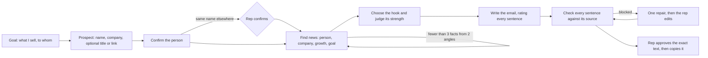

# Outreach Workbench: overview

Personalised outreach, from prospect to draft. A rep names a prospect; the
workbench researches public sources, picks the most relevant hook, and drafts a short
email in which every sentence traces to a source. A person approves the exact text.
Nothing is ever sent from the tool.

- **Run it:** hosted link (password shared privately), or locally: see
  [WORKBENCH_RUNNING.md](WORKBENCH_RUNNING.md), section 2.
- **Evaluation:** [WORKBENCH_EVALUATION.md](WORKBENCH_EVALUATION.md), also in the app under
  **Evaluation**. On 15 real executives across three different pitches: 14 of 15 emails
  ready to send (11 as written, 3 after one small edit), 0 wrong facts, 27 seconds and
  $0.020 per prospect, 12 Strong hooks.

## 1. The process

| Stage | Input | Decision | Output |
| --- | --- | --- | --- |
| Confirm the person | Name, company, optional title or link | Is a page we read about *this* person at *this* company? Same name elsewhere stops for the rep | Identity with its source, or a question |
| Find news | Identity, goal | Search four angles; keep reading until 3 facts from 2 angles, within the run's limits | Sources (read, excerpt, preview-only) and dated facts |
| Choose the hook | Facts | Gate each fact (about them, dated, from a read page, not contradicted, not old news re-dated), then rank by relevance to the goal | One hook with a plain judgement: what it has, what it lacks |
| Write | Hook, chosen facts, goal | One thread, 50–100 words; every sentence rated core / supporting / offer / optional | Draft with a source for each sentence |
| Check | Draft, sources | Deterministic rules: no invented pain, numbers, dates, titles, certainty or outcomes | Pass, notices, or blocking problems with reasons |
| Review | Checked draft | The rep removes, edits, rewrites with other facts, approves | The exact approved text, copied by the rep |

The pipeline never returns nothing. If research is thin, it walks down a ladder:
checked signal → softer signal → role → company fact → company page → what the rep
typed. The hook is labelled Strong, Good, Weaker or Not personalised, with reasons.

## 2. Edge cases

| Case | Why it's realistic | What the process does |
| --- | --- | --- |
| **The draft says more than the evidence** | Language models add plausible pain points and numbers; that's what gets a rep embarrassed | Every sentence is checked against its source. Invented problems, numbers, dates, titles and certainty block approval with a named reason; one click removes the sentence |
| **Two people, same name** | Common names produce confidently wrong emails about someone else | Identity is resolved from read pages before any hook. A same-name person at another company stops the run for the rep; their news is never used |
| **Too little public information** | Many finance leaders have almost no press | Blocked, sign-in and LinkedIn pages are never proof. It still produces an email from what it can stand behind, marked as a weaker hook, saying what's missing |
| **Old news, republished** | Aggregators re-date old stories; "congrats on the new role" two years late kills credibility | Event dates are checked against the text and datelines. Old events and conflicting reports are set aside with reasons; nothing old is called recent |

Built in and tested but not part of the four: provider failures and uncertain charges
(held, never replayed; a free template email still comes out), the spending limits,
and restarts mid-run (saved stages survive).

## 3. Main decisions

- **Evidence over fluency.** A model writes the email, but deterministic rules decide
  what may be said. A source sentence is shown for every claim, so a reviewer checks in
  seconds instead of re-researching.
- **Relevance colours instead of more rules.** The writer rates each sentence while
  writing. The rep sees at a glance what is the reason for writing and what is
  optional, and can cut optional sentences in one click. Nothing is silently dropped.
- **Minimum research standard.** Stopping at the first fact gave thin emails. Thorough
  mode searches four angles and continues until three facts from two angles, or the
  limits are reached. Quick mode exists for cost.
- **Never empty, always labelled.** An email marked "Weaker hook: role only" is more
  useful to an SDR than "No result", as long as it is honest about it.
- **The right model for each step, hard limits.** Research runs on Claude Haiku 5.5,
  which is cheap and reliable for reading. The email is written by Claude Sonnet 5.5,
  because writing is where quality shows; Haiku takes over if the run's limit is short.
  Search with Parallel. Each run is capped at $0.05 and each day at $0.50. A typical
  Thorough run with an email costs about $0.02 and takes under a minute. Every paid
  request is recorded in a ledger; an uncertain one is never replayed.
- **Human approval of exact text.** Approval binds to one version; any edit is checked
  again. The tool has no sending, inbox or accounts by design.
- **Goal is editable and optional.** The goal decides what is relevant. Research-only
  runs skip the email to save cost.
- **Scale.** "Many at once" takes up to 20 pasted prospects with the same checks, three
  at a time; each email is still approved one by one.

## 4. Assumptions

- The rep knows who they are targeting (name and company); the tool doesn't find leads.
- Public web sources only. LinkedIn is used as a hint, never as proof, because it can't
  be read reliably or within its terms.
- The offer in the demo (ClearLedger invoice review) is fictional; prospects in live
  mode are real public business figures; the fictional examples are invented people.
- English-language sources; one email per prospect; no follow-up sequences.

## 5. Known limits

- Live quality depends on what the search provider returns; some runs end with a
  weaker hook even for well-known people.
- The claim rules are word-level. They catch invented specifics reliably but can flag
  a fluent paraphrase as a notice (not a block).
- Concurrency is one process with a small worker pool; enough for a team's daily list,
  not for thousands.
- The hosted version uses one shared password, not individual accounts.

## 6. What I'd build next

1. **Choosable rule strictness at the start:** let the rep or team decide what counts
   as a strong or weak claim (for example, allow company-only hooks, or require a dated
   event about the person). Today these thresholds are fixed in code.
2. Reply-rate feedback: record which hooks got replies and feed that into ranking.
3. CRM import and export. Today a batch takes a pasted list (one prospect per line,
   or spreadsheet columns pasted in) and exports its approved emails as one text file.
4. Per-user accounts and team-level budgets on the hosted version.
